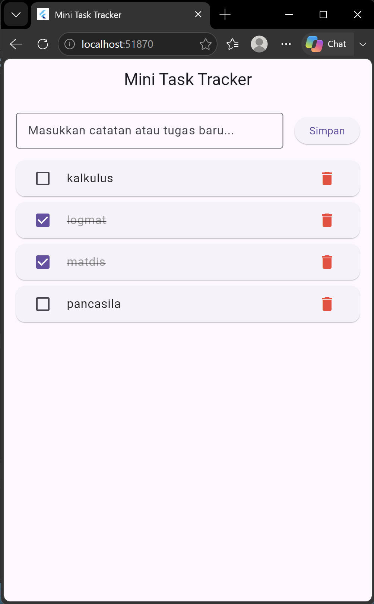

# Mini Task Tracker

Aplikasi mobile sederhana berbasis Flutter untuk mencatat dan mengelola daftar tugas harian. Aplikasi ini memungkinkan pengguna menambahkan tugas, menandai tugas yang telah selesai, serta menghapus tugas dari daftar.

## Preview Aplikasi



## Fitur Utama

- Tambah Tugas: Menambahkan tugas baru melalui kolom input.
- Daftar Tugas: Menampilkan seluruh tugas yang telah ditambahkan.
- Tandai Selesai: Mengubah status tugas menjadi selesai menggunakan tombol centang.
- Hapus Tugas: Menghapus tugas dari daftar.

## Tech Stack

- Framework: Flutter
- Programming Language: Dart
- State Management: setState
- IDE: Visual Studio Code

## Struktur Proyek

mini_task_tracker/
├── android/
├── ios/
├── lib/
│   ├── main.dart
│   └── task_page.dart
├── screenshot/
│   └── preview.png
├── web/
├── windows/
├── .gitignore
├── pubspec.lock
├── pubspec.yaml
└── README.md

## How to Run

Pastikan Flutter SDK dan Android Studio atau emulator Android sudah terpasang.

1. Clone repositori:

   ```bash
   git clone https://github.com/marinozk/mini_task_tracker.git
   ```

2. Masuk ke direktori proyek:

   ```bash
   cd mini_task_tracker
   ```

3. Install dependencies:

   ```bash
   flutter pub get
   ```

4. Jalankan aplikasi:

   ```bash
   flutter run
   ```

## Build APK

Untuk membuat file APK, jalankan perintah:

```bash
flutter build apk --release
```

File APK hasil build dapat ditemukan di:

```text
build/app/outputs/flutter-apk/app-release.apk
```

## Identitas Peserta

- Nama: Azka Fauzi Marino
- NIM: 103012600222

## Deklarasi Penggunaan AI

- Apakah menggunakan AI? Ya

- Tool AI yang digunakan: Gemini

- Estimasi persentase kontribusi AI: 30%

- Bagian kode/fitur yang dibantu AI:
  - Konsultasi dan referensi dalam memahami alur
    pengembangan aplikasi Flutter.
  - Membantu mengidentifikasi dan memperbaiki error
    selama proses pengembangan.
  - Memberikan referensi penggunaan syntax dan
    komponen Flutter.

- Pernyataan:

  "Saya menyatakan bahwa saya memahami alur dan fungsi dari seluruh kode yang ada dalam repositori ini."
  